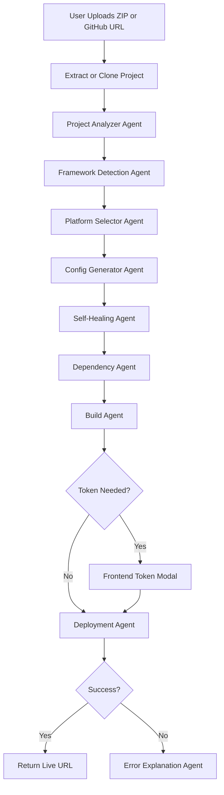

# AutoDeploy Agent

AutoDeploy Agent is an Agentic AI-based DevOps assistant that helps beginners deploy projects automatically.

It accepts a ZIP project or GitHub repository URL, scans the files, detects the tech stack, selects a suitable deployment platform, generates configuration files, installs dependencies, builds the project, asks for a token when needed, and returns a live deployment URL.

---

## Problem Statement

Beginners often struggle with deployment because each tech stack requires different commands, build folders, platform settings, environment variables, and tokens.

Examples:

- React + Vite needs `dist`
- React CRA needs `build`
- Flask/FastAPI needs a start command and port binding
- Django needs collectstatic and WSGI setup
- Spring Boot needs Maven/Gradle packaging
- .NET needs publish settings

AutoDeploy Agent solves this by automating the deployment decision and workflow.

---

## Proposed Solution

The system uses multiple agents:

1. Manager Agent
2. Project Analyzer Agent
3. Framework Detection Agent
4. Platform Selector Agent
5. Config Generator Agent
6. Dependency Agent
7. Build Agent
8. Deployment Agent
9. Error Explanation Agent
10. Self-Healing Agent

---

## Workflow Diagram



---

## Tech Stack

### Backend

- FastAPI
- SQLite
- Python subprocess with safe command execution
- ZIP validation
- GitHub clone support

### Frontend

- React
- Vite
- CSS glassmorphism UI
- Token input modal style section
- Deployment logs viewer

### Database

SQLite table: `deployments`

---

## Supported Frameworks

### Frontend

- HTML/CSS/JS
- React
- React + Vite
- Next.js
- Vue
- Angular

### Backend

- Node.js
- Express.js
- Flask
- FastAPI
- Django

### Full Stack

- MERN
- MEAN
- React + Flask
- React + FastAPI
- Next.js full stack

### Java

- Spring Boot
- Maven
- Gradle
- Java Servlet

### .NET

- ASP.NET Core
- .NET Web API

---

## Supported Platforms

| Platform | Best For | Token |
|---|---|---|
| Netlify | Static frontend, React, Vite, Vue, Angular | NETLIFY_AUTH_TOKEN |
| Vercel | Next.js, React, Vite | VERCEL_TOKEN |
| Railway | Backend and full-stack apps | RAILWAY_TOKEN |
| Render | Flask, FastAPI, Django, Node, Docker | RENDER_API_KEY |
| Azure | .NET and Java enterprise apps | Azure login |

---

## Installation

### 1. Clone or unzip this project

```bash
cd autodeploy-agent
```

### 2. Run Backend

```bash
cd backend
python -m venv venv
venv\Scripts\activate
pip install -r requirements.txt
uvicorn main:app --reload
```

Backend runs at:

```text
http://localhost:8000
```

### 3. Run Frontend

Open a new terminal:

```bash
cd frontend
npm install --legacy-peer-deps
npm run dev
```

Frontend runs at:

```text
http://localhost:5173
```

---

## How to Use

1. Open frontend.
2. Upload a ZIP project or enter GitHub repository URL.
3. Wait for analysis.
4. Check detected framework and platform.
5. Choose Simulation Mode first.
6. Click Start Deployment.
7. See fake live URL.
8. For real deployment, select Real Deployment Mode and enter platform token.

---

## Simulation Mode

Simulation mode:

- Scans project
- Detects framework
- Generates config files
- Runs dependency/build commands when available
- Returns a fake deployment URL

This is safest for testing.

---

## Real Deployment Mode

Real mode currently supports CLI-based deployment for:

- Netlify
- Vercel
- Railway

You must install the platform CLI first.

### Netlify CLI

```bash
npm install -g netlify-cli
```

### Vercel CLI

```bash
npm install -g vercel
```

### Railway CLI

```bash
npm install -g @railway/cli
```

---

## How to Get Netlify Token

1. Login to Netlify.
2. Go to User Settings.
3. Open Applications.
4. Create Personal Access Token.
5. Copy token.
6. Paste it in AutoDeploy Agent when asked.

---

## How to Get Vercel Token

1. Login to Vercel.
2. Go to Account Settings.
3. Open Tokens.
4. Create token.
5. Copy token.
6. Paste it in AutoDeploy Agent when asked.

---

## Security Notes

- Tokens are not stored permanently.
- Tokens are masked in logs.
- ZIP files are validated before extraction.
- Unsafe ZIP paths are blocked.
- Dangerous commands are blocked.
- Shell execution is disabled.
- Real deployment should be confirmed by the user.

---

## Sample Projects

Inside `sample-projects`, you will find:

1. `sample-html-site.zip`
2. `sample-react-vite.zip`
3. `sample-fastapi.zip`

Use them to test upload and analysis.

---

## Future Enhancements

- Real Render API deployment
- Azure deployment automation
- Docker image deployment
- Environment variable UI
- WebSocket real-time logs
- User login and deployment history
- Delete uploaded files button
- Advanced AI reasoning using LangChain/CrewAI
